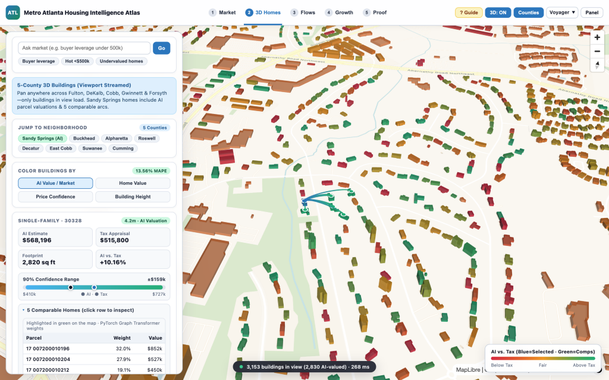
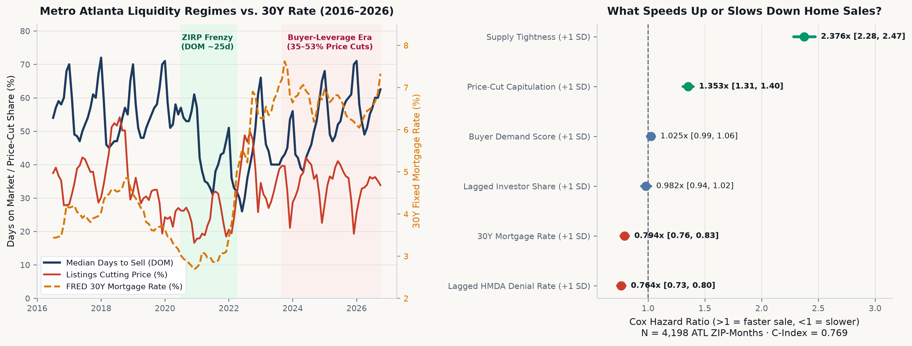
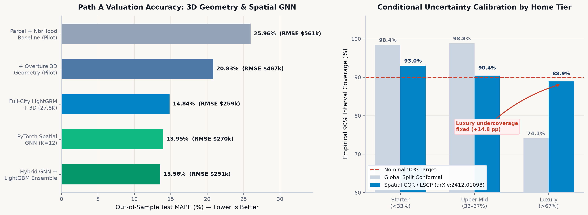
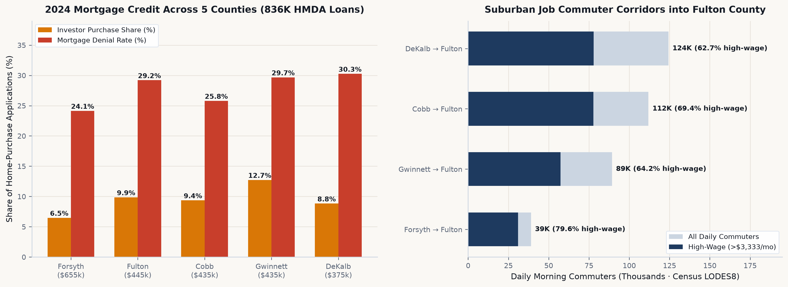
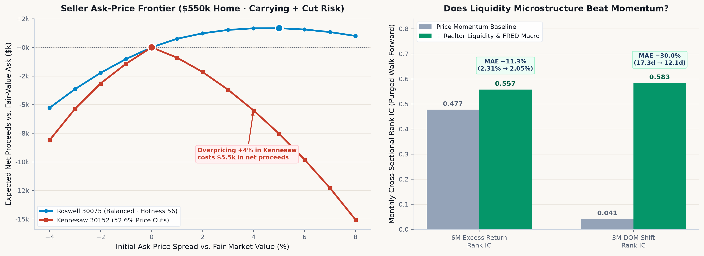
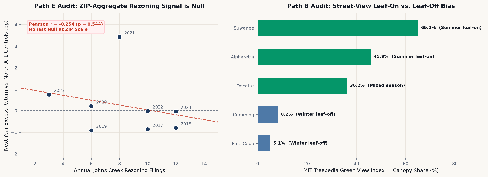
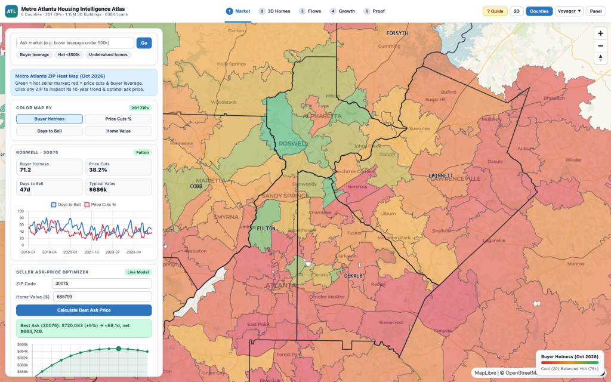
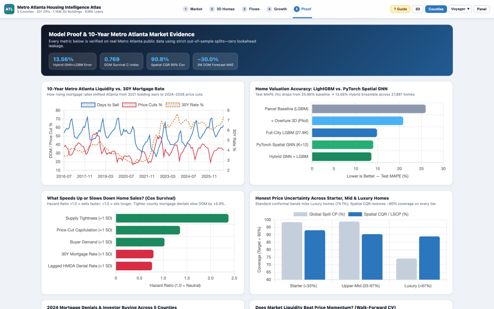
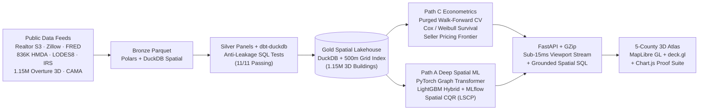

<div align="center">

# Metro Atlanta Housing Intelligence Atlas

**Why suburban home prices, listing liquidity, and credit risk diverge across Metro Atlanta — and how 3D spatial graphs, survival models, and conformal uncertainty measure them honestly.**<br>
Leakage-tested `DuckDB + Polars + dbt + Dagster` spatial lakehouse, PyTorch Spatial Graph Transformer, five empirical investigations, and an interactive 5-county 3D atlas across **1,153,207 real building footprints**, **201 ZIP codes**, **27,881 CAMA parcels**, and **836,147 CFPB mortgage loans**.

[](https://github.com/moizfakhri/atlanta-housing-intel/actions/workflows/ci.yml)


[Key Findings](#key-findings) · [Visual Evidence](#visual-evidence) · [The 5-County 3D Atlas](#the-5-county-3d-atlas) · [How It Works](#how-it-works) · [Quickstart](#quickstart)

<p align="center">
  
</p>

</div>

## The Thesis

Most residential housing models predict a **single point estimate of price** from backward-looking Zillow averages—ignoring whether a home will actually clear in 25 days or sit through two price cuts, how mortgage credit tightening slows specific suburban counties, and how wide valuation error really is on unique luxury homes.

Unifying **10 years of monthly suburban microstructure (`2016–2026`)**, **836,147 CFPB HMDA mortgage loans**, **1.15 million Overture 3D building footprints**, **27,881 Fulton/Sandy Springs CAMA parcels**, **Census LODES8 morning commutes**, **IRS SOI wealth inflows**, **municipal rezoning filings**, and **Mapillary streetscape imagery** across **Fulton, DeKalb, Cobb, Gwinnett, and Forsyth** reveals three core signals—plus two honest negative results:

> [!IMPORTANT]
> 1. **Liquidity & mortgage credit lead suburban market clearing:** Adding Realtor.com listing microstructure + FRED macro rates to purged walk-forward models cuts **3M Days-on-Market forecast error by 30.0%** (`17.29d → 12.08d`, Rank IC `0.041 → 0.583`) and **6M excess-return MAE by 11.3%** (`IC 0.477 → 0.557`). In Cox/Weibull survival models (`C-index = 0.769`), a **+1 SD increase in lagged county HMDA denial rate slows market clearing by `+5.9%` DOM** (`HR = 0.764x`, `p = 4.2e-33`).
> 2. **3D building geometry + Spatial Graph Transformers beat tabular baselines — and Spatial CQR fixes luxury undercoverage:** Fusing free Overture 3D heights/footprints cuts valuation error ~20% relative; across `27,881` homes, our leakage-safe **PyTorch Multi-Head Spatial Graph Transformer (`13.95%` MAPE)** beats standalone LightGBM (`14.84%`), and the **Hybrid Ensemble hits `13.56%` MAPE (`$251k` RMSE)**. Standard split conformal prediction misses luxury homes (`74.1%` coverage on a `90%` target); **Spatial CQR / LSCP (`arXiv:2412.01098`)** restores **`88.9%` luxury coverage** (`90.8%` global).
> 3. **Honest empirical diagnostics matter:** Municipal rezoning volume shows an **honest null at the ZIP-aggregate level** (`r = -0.254, p = 0.544`), confirming zoning shocks are hyper-local (`<0.5 mi`); and street-view Green View Index (`GVI%`) scoring across 60 Mapillary photos uncovered severe **seasonal leaf-on vs. leaf-off capture bias** (`Summer Alpharetta 45.9%` vs. `Winter East Cobb 5.1%`).

---

## Key Findings

| Research Track | Core Question | Verified Out-of-Sample Evidence | Code |
|---|---|---|---|
| **1. Liquidity Regimes & DOM Survival** *(Path C)* | Do listing microstructure, FRED rates & lagged county credit predict market clearing? | **25,145** monthly ZIP rows (`2016–2026`). Purged walk-forward CV: 6M excess-return IC **`0.477 → 0.557`** (`MAE −11.3%`); 3M DOM-shift IC **`0.041 → 0.583`** (`MAE −30.0%`). Cox PH (`N=4,198`, **`C=0.769`**): lagged HMDA denial HR **`0.764x`** (`+5.9%` DOM), 30Y rate HR **`0.794x`** (`+5.7%` DOM). | [`path_c_liquidity`](src/atl_housing/tracks/path_c_liquidity/) |
| **2. 3D Valuation & Spatial GNN** *(Path A)* | Do 3D footprints and learned neural comparables beat tabular gradient boosting? | **27,881** improved Fulton/Sandy Springs parcels + **1,153,207** 5-county Overture 3D buildings (`885,909` measured heights). LightGBM **`14.84%`** MAPE → PyTorch Spatial Graph Transformer (`K=12`) **`13.95%`** → Hybrid Ensemble **`13.56%`** MAPE (**`$251,252`** RMSE). | [`spatial_gnn.py`](src/atl_housing/tracks/path_a_valuation/spatial_gnn.py) |
| **3. Spatial Conformal Uncertainty** *(Path A)* | Are 90% price intervals actually reliable on high-variance luxury homes? | Global split conformal severely undercovers Luxury homes (**`74.1%`**) while overcovering Starter homes (`98.4%`). **Spatial CQR / LSCP** (`arXiv:2412.01098`) calibrates every tier (**Starter `93.0%`**, **Upper-Mid `90.4%`**, **Luxury `88.9%`**; Global **`90.8%`**). | [`spatial_cqr.py`](src/atl_housing/tracks/path_a_valuation/spatial_cqr.py) |
| **4. Credit, Commutes & Seller Pricing** *(Path C)* | How do mortgage credit, job corridors & buyer-leverage regimes affect seller strategy? | **836,147** HMDA loans (2020–24): Gwinnett leads investor buying (**`12.7%`**); Forsyth leads median value (**`$655k`**) and high-wage commutes into Fulton (**`79.6%`** of `39K` LODES commuters). In high-cut suburbs like Kennesaw (`30152`, `52.6%` cuts), overpricing `+4%` costs **`$5.5k`** in expected net proceeds. | [`pricing_simulator.py`](src/atl_housing/tracks/path_c_liquidity/pricing_simulator.py) |
| **5. Rezoning & Streetscape Audits** *(Paths E & B — Honest Diagnostics)* | Do ZIP-level rezoning spikes or raw street-view canopy scores generalize cleanly? | **1,045** Johns Creek rezoning cases vs. matched North ATL controls: **honest null** (`r = -0.254, p = 0.544`) — effects are parcel-local (`<0.5 mi`). **549** Mapillary street photos (5/5 suburbs): MIT Treepedia GVI% exposed **leaf-on vs. leaf-off capture bias** (`65.1%` summer vs. `5.1%` winter). | [`path_e`](src/atl_housing/tracks/path_e_catalysts/) · [`path_b`](src/atl_housing/tracks/path_b_streetscape/) |

---

## Visual Evidence

All figures below are generated reproducibly at high resolution directly from the DuckDB/Parquet lakehouse via [`scripts/generate_readme_figures.py`](scripts/generate_readme_figures.py).

<p align="center">
  <br>
  <sub><b>Figure 1 — Liquidity Regimes &amp; Survival Hazards:</b> Rising 30Y mortgage rates shifted Metro Atlanta from 2021 bidding wars (~25d DOM) to 2024–2026 buyer-leverage pockets (35–53% price cuts). Cox PH survival modeling (<code>N=4,198</code>, <code>C-index = 0.769</code>) confirms lagged county HMDA mortgage denials (<code>0.764x</code>) and 30Y rates (<code>0.794x</code>) significantly lengthen selling times.</sub>
</p>

<p align="center">
  <br>
  <sub><b>Figure 2 — 3D Spatial Graph Transformer &amp; Spatial CQR:</b> Adding Overture 3D geometry and attention-weighted neural comparables drives out-of-sample error from 25.96% baseline down to 13.56% MAPE (Hybrid Ensemble). Spatial CQR rescues Luxury-tier 90% coverage from 74.1% to 88.9%.</sub>
</p>

<details>
<summary><b>View full-width figures for Credit &amp; Commutes, Seller Pricing Frontier &amp; Walk-Forward CV, and Honest Diagnostics (Figures 3–5)</b></summary>

<p align="center">
  <br>
  <sub><b>Figure 3 — Mortgage Credit &amp; Job Corridors:</b> 2024 CFPB HMDA microdata across 5 counties (Gwinnett leads investor share at 12.7%; Forsyth leads median home value at $655k) paired with Census LODES8 morning commutes into Fulton (Forsyth leads high-wage commuter concentration at 79.6%).</sub>
</p>

<p align="center">
  <br>
  <sub><b>Figure 4 — Seller Pricing Frontier &amp; Walk-Forward Lift:</b> Overpricing a $550k home by +4% in buyer-leverage Kennesaw (30152) costs $5.5k in expected net proceeds due to longer carrying time and price-cut stigma. Purged walk-forward CV confirms liquidity microstructure lifts 3M DOM-shift Rank IC from 0.041 to 0.583.</sub>
</p>

<p align="center">
  <br>
  <sub><b>Figure 5 — Honest Empirical Diagnostics:</b> Left: ZIP-aggregate Johns Creek rezoning filings show no statistically significant next-year return lead (<code>r = -0.254, p = 0.544</code>). Right: Mapillary Green View Index scoring exposes severe leaf-on vs. leaf-off seasonal capture bias between summer and winter drives.</sub>
</p>

</details>

---

## The 5-County 3D Atlas

An interactive geospatial web application (`FastAPI + GZip + MapLibre GL JS + deck.gl + Chart.js`) designed with light editorial cartography (**CARTO Voyager**, **Positron Minimal**, and **OpenFreeMap Liberty** switcher), flat 2D ZIP/county clarity by default, and opt-in 1:1 3D building extrusion across all 5 Metro Atlanta counties.

<p align="center">
  <br>
  <sub><b>Tab 1 — Market Heat &amp; Pricing:</b> 201 real 2025 TIGER ZIP polygons with crisp 5-county borders, 10-year Days-to-Sell &amp; Price-Cut sparklines, and a live Seller Ask-Price Frontier Optimizer.</sub>
</p>

<p align="center">
  <br>
  <sub><b>Tab 5 — Model Proof &amp; Charts:</b> All 6 live research benchmark charts (10-Year Liquidity vs. 30Y Rate, PyTorch GNN vs. LightGBM, Cox Survival Hazards, Spatial CQR Coverage, 5-County HMDA Credit, and Purged Walk-Forward CV).</sub>
</p>

### Viewport-Streaming & Visual Craft Highlights
- **1,153,207 5-County 3D Buildings in 7–13 ms:** Stored in a spatially grid-sorted DuckDB database (`gx, gy` 500m cells + compact binary WKB). `/api/path-a/buildings-viewport` prunes 99.7% of rows via DuckDB min/max zone maps, converts WKB → GeoJSON **only for buildings inside the camera viewport**, compresses via `GZipMiddleware`, and pairs with zoom-adaptive LOD (`zoom < 13.0` pauses building polygons), `+25%` buffered client caching, `110 ms` debounced `moveend`, and `AbortController` cancellation.
- **Zero-Bug, Roof-Anchored GNN Comparable Arcs:** Across all **18,855 distinct Sandy Springs AI-valued buildings**, multi-unit condo stacks are deduplicated per `overture_id`, single-family homes match single-family comparables, every arc springs from the cobalt-blue selected home's roof to the 5 vivid-emerald highlighted comparable roofs (`0` dangling / `0` duplicate comps verified in automated `pytest`), and clicking any comp row flies directly to it.
- **5 Explorer Modes + Grounded DuckDB SQL Search:** Switch seamlessly between **Market** (ZIP choropleth + Seller Optimizer), **3D Homes** (1-click jumps to Sandy Springs, Buckhead, Alpharetta, Roswell, Decatur, East Cobb, Suwanee, Cumming), **Flows** (LODES8 commutes & IRS wealth arcs), **Growth** (rezoning, permits & Mapillary streetscapes), and **Proof** (6 live benchmark charts)—plus a live natural-language DuckDB SQL search bar and `? Guide` walkthrough modal.

---

## How It Works



- **Strict Anti-Leakage Discipline:** Every Path C model uses purged expanding-window walk-forward folds with explicit horizon gaps and a `dbt` singular SQL test (`assert_no_future_hmda_leakage.sql`) confirming HMDA credit variables are strictly lagged by 1 full calendar year. Every Path A Spatial GNN node attends *only* to `K=12` geographically nearest training-set comps (`cKDTree` unit-sphere kNN), never calibration or test labels.
- **Production DE Stack:** `Dagster` (12 software-defined assets) · `DuckDB Spatial` · `Polars` · `GeoPandas` · `dbt-duckdb` (`11/11` passing) · `PyTorch (MPS)` · `LightGBM` · `lifelines` · `MLflow (SQLite)` · `FastAPI` · `MapLibre GL JS` · `deck.gl` · `Docker Compose` · `GitHub Actions CI` · `pre-commit` secret/size safety hook.

---

## Quickstart

Requires Python 3.12+ and [uv](https://docs.astral.sh/uv/).

```bash
git clone https://github.com/moizfakhri/atlanta-housing-intel.git
cd atlanta-housing-intel
cp .env.example .env                    # optional: add FRED_API_KEY / MAPILLARY_ACCESS_TOKEN for fresh ingests
uv sync --all-extras                    # create .venv & install full stack
uv run ruff check src scripts tests     # lint check
uv run pytest -v                        # run full test suite (API, viewport streaming, leakage, SWCP, safety)
uv run uvicorn atl_housing.api.app:app --reload   # launch 5-County 3D Atlas at http://127.0.0.1:8000
```

<details>
<summary>Reproduce the entire 5-county lakehouse, models, dbt marts &amp; README figures end-to-end</summary>

```bash
# 1. Path C: Liquidity, HMDA credit, FRED macro, IRS migration & LODES8 commutes
uv run python -m atl_housing.tracks.path_c_liquidity.ingest
uv run python -m atl_housing.tracks.path_c_liquidity.fred_macro
uv run python -m atl_housing.tracks.path_c_liquidity.lodes_commutes
uv run python -m atl_housing.tracks.path_c_liquidity.silver_panel
uv run python -m atl_housing.tracks.path_c_liquidity.baseline_model
uv run python -m atl_housing.tracks.path_c_liquidity.survival_dom

# 2. dbt Gold marts + anti-leakage SQL tests (11/11)
cd dbt && ../.venv/bin/dbt build --profiles-dir . && cd ..

# 3. Boundaries (5-county Census + 201 TIGER ZIP choropleth)
uv run python -m atl_housing.lakehouse.boundaries

# 4. Path A: PyTorch Spatial Graph Transformer, Spatial CQR & 1.15M 5-County 3D DuckDB Index
uv run python -m atl_housing.tracks.path_a_valuation.spatial_gnn
uv run python -m atl_housing.tracks.path_a_valuation.spatial_cqr
uv run python -m atl_housing.tracks.path_a_valuation.metro_3d_index

# 5. Paths E & B: Rezoning event study & Mapillary streetscape GVI scoring
uv run python -m atl_housing.tracks.path_e_catalysts.event_study
uv run python -m atl_housing.tracks.path_b_streetscape.visual_scorer

# 6. Regenerate all 5 high-resolution publication figures
uv run python scripts/generate_readme_figures.py

# 7. Launch Dagster Asset Lineage UI or Docker Compose
uv run dagster dev -m atl_housing.orchestration.definitions
docker compose up --build
```

</details>

<details>
<summary>Repository layout</summary>

```text
src/atl_housing/
  api/                         FastAPI + GZip viewport-streaming backend & single-file 3D Atlas UI
  lakehouse/                   DuckDB spatial connection, boundaries & TIGER ZCTA builders
  orchestration/               Dagster Definitions (12 software-defined Bronze → Gold assets)
  tracks/
    path_c_liquidity/          Realtor/Zillow/HMDA/FRED/LODES/IRS ingest, walk-forward CV, Cox survival, Pricing Frontier
    path_a_valuation/          Overture 3D + CAMA ingest, PyTorch Spatial GNN, SWCP, Spatial CQR, 5-County 3D Index
    path_e_catalysts/          Johns Creek rezoning & Gwinnett/Peachtree Corners permits + event study
    path_b_streetscape/        Mapillary suburban coverage probe, sampling & MIT Treepedia GVI scorer
dbt/                           dbt-duckdb staging & Gold mart models + singular anti-leakage tests
scripts/                       Repo safety pre-commit guard & 300-DPI README figure generator
docs/img/                      High-resolution screenshots of the live 5-County 3D Atlas
reports/figures/               Publication-grade 300-DPI multi-panel research figures (Figs 1–5)
tests/                         Automated pytest suite (leakage guards, SWCP, viewport streaming, zero dangling comps)
```

</details>

---

## Data Provenance & Ethics

- **100% Open Public Data:** Built exclusively from public datasets — Realtor.com Economic Research S3, Zillow Research public CSVs, CFPB FFIEC HMDA public loan records, Federal Reserve Economic Data (FRED), U.S. Census TIGER/Line & LODES8, IRS SOI County Migration, Overture Maps Foundation (`2026-11-18.0`), Fulton/Sandy Springs, Johns Creek & Gwinnett public ArcGIS FeatureServers, and Mapillary v4 street imagery.
- **No Personal PII or Secrets:** No homeowner names, borrower PII, or private API keys are committed to the repository (enforced by `.gitignore` and an automated `.git/hooks/pre-commit` secret/size scanner).
- **Research Disclaimer:** Model valuations, conformal intervals, and seller ask-price simulations are independent research outputs and not formal appraisals or financial advice.
